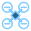

# Three.js Gadgets

A collection of interactive 3D demos built with [Three.js](https://threejs.org/), deployed live via GitHub Pages.

## Live site

https://zmath01.github.io/threejs-gadgets

## Demos

| Demo | Description | File |
| --- | --- | --- |
| ⚙️ Differential Simulation | Differential with carrier RPM, playback, and wheel-speed controls | [`differential-01.html`](differential-01.html) |
| 🏎️ F1 Systems Lab | Power unit & dynamics visualizer with engine/gearbox telemetry | [`f1-system-full.html`](f1-system-full.html) |
| 🧊 Mental Rotation Trainer | Shepard–Metzler-style same-or-mirror practice at controlled angles | [`mental-rotation-test.html`](mental-rotation-test.html) |
| ✨ Compute Showcase | Matrix math, particle physics, and Game of Life with per-demo controls | [`matrix-particles-game.html`](matrix-particles-game.html) |
|  Drone Simulation | Compare PD and MPC tracking with Kalman or ideal state feedback | [`drone-simulation.html`](drone-simulation.html) |

## Tech stack

- **Three.js** — loaded from CDN (jsdelivr / unpkg / cdnjs), no build step or local dependencies
- **GitHub Pages + GitHub Actions** — automatic deploy on push to `main`

## Development

Open a demo’s HTML file in a browser with the repository assets alongside it and a connection to the Three.js CDN.

Run the flight control regression tests with `node --test tests/drone-control.test.cjs`.

## Deploy

Everything is deployed automatically by the workflow in [`.github/workflows/deploy.yml`](.github/workflows/deploy.yml) whenever you push to `main`.

1. Push to the `main` branch.
2. In the repo go to **Settings → Pages** and set **Build and deployment → Source → GitHub Actions**.
3. The latest push is live at `https://zmath01.github.io/threejs-gadgets`.

## License

[MIT](LICENSE) © 2026 zmath01